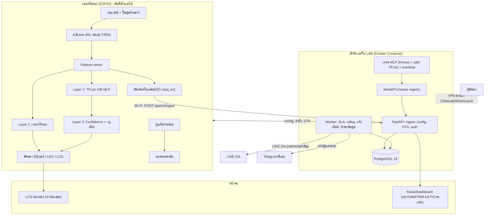
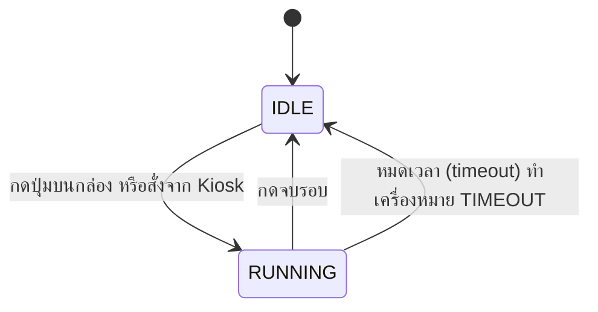
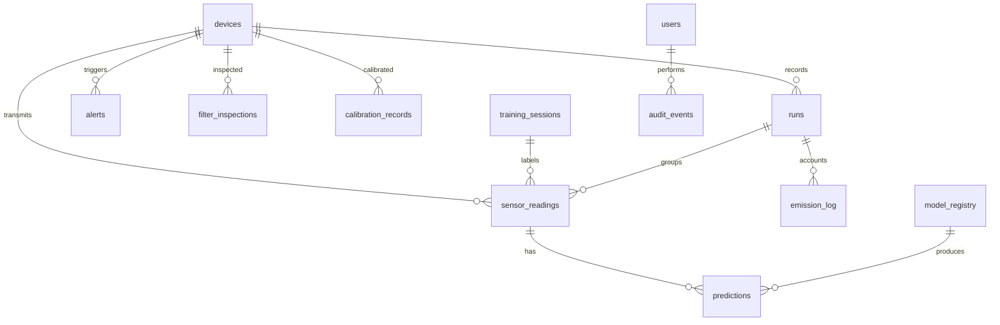

# CORE_SPEC — กล่อง IoT ตรวจวัดอากาศที่ปล่องตู้พ่นสี พร้อม ML บน ESP32

> **เวอร์ชัน:** 0.1 (ร่างแรก) | **วันที่:** 7 พฤศจิกายน 2569 (2026-11-07)
> **สถานะ:** ร่างเพื่อทบทวน ยังไม่ใช่ฉบับอนุมัติ

---

## 0. วิธีใช้เอกสารนี้ (กฎกันแก่นเปลี่ยน)

1. ไฟล์นี้คือ **แหล่งความจริงเดียว (single source of truth)** ทุกไดอะแกรม โค้ด สไลด์ และเล่มรายงานต้องอ้างอิงจากที่นี่
2. ถ้าจะเปลี่ยนแก่น (ฮาร์ดแวร์ ฟีเจอร์ label เกณฑ์ สคีมา API) ให้ **แก้ไฟล์นี้ก่อน** แล้วบันทึกใน Changelog (หัวข้อ 20) แล้วจึงแก้โค้ด
3. ป้ายสถานะที่ใช้ในเอกสาร:

| ป้าย | ความหมาย |
|---|---|
| **[ล็อก]** | ตัดสินใจแล้ว ไม่เปลี่ยนโดยไม่แก้เอกสารนี้ |
| **[รอยืนยัน]** | มีค่าเริ่มต้นแนะนำ แต่ต้องยืนยันกับโรงงานหรือข้อมูลจริง |
| **[Roadmap]** | ออกแบบรองรับไว้ ยังไม่ทำในขอบเขตโครงงาน |
| **[ข้อสันนิษฐาน]** | ข้อเสนอของผู้ร่าง ยังไม่ผ่านการยืนยันจากเจ้าของโครงการ |

---

## 1. เป้าหมายและขอบเขต

### 1.1 ผลงานหลัก (Core Value) **[ล็อก]**

**กล่อง IoT ที่ติดที่ปล่องหลังฟิลเตอร์ของตู้พ่นสี อ่านเซนเซอร์ คาลิเบรต และรันโมเดล ML (TFLite Micro) บนชิป ESP32 โดยตรง ตัดสินใจและทำงานต่อได้เองเมื่อไม่มีอินเทอร์เน็ต** ส่วนเว็บแพลตฟอร์มทำหน้าที่เก็บข้อมูล ติด label เทรนโมเดลนอกกล่อง แปลงเป็น TFLite แล้วส่งลงกล่องผ่าน OTA พร้อมแสดงผลและแจ้งเตือน

### 1.2 ขอบเขตงาน

| ระดับ | รายการ |
|---|---|
| **Must** | Edge ML classifier บน ESP32; Data collection + labeling; Train → TFLite → OTA (มี rollback); ทำงานเองเมื่อออฟไลน์ (LCD, บัฟเฟอร์, ปุ่มเริ่ม/จบรอบบนกล่อง); ระบบ A (ขีดจำกัดความปลอดภัย + alert); บันทึกรอบพ่น (run); บัญชีการปล่อยชั้น 0; บันทึกการตรวจฟิลเตอร์ + ภาพถ่าย; การดูแลระยะไกล |
| **Should** | บัญชีการปล่อยชั้น 1 (เมื่อรู้ Q); Kiosk (PIN, บทบาท 3 แบบ); LINE OA แบบประหยัดโควตา; สรุปรายวัน |
| **Roadmap** | บัญชีชั้น 2 (โควตาต่อปี) เมื่อมีตัวเลขจากแหล่งจริง; ลายเซ็น ECDSA ของ OTA; Audit log แบบ hash chain; โปรไฟล์ SOLVENT ที่ทดสอบกับสีน้ำมันจริง; ฮาร์ดแวร์ Rev A เต็มรูป; CEMS/รายงานตามกฎหมาย |

### 1.3 ข้อห้ามกล่าวอ้าง (Non-claims) **[ล็อก]**

- ไม่อ้างว่าเป็น CEMS และไม่อ้างว่าผ่านหรือรองรับกฎหมาย/มาตรฐานใด
- ตัวเลขมวลที่ปล่อยเป็น **"ค่าประมาณ"** เสมอ
- ข้อมูลกฎหมายที่มีในมือคือ **ขีดจำกัดการสัมผัสในที่ทำงาน (OEL)** และมาตรฐานคุณภาพอากาศโดยรอบ/ดิน ซึ่งไม่ใช่โควตามวลต่อปี จึงไม่มีโควตาให้คำนวณจนกว่าจะได้ตัวเลขจากใบอนุญาต/EIA/เป้าหมายบริษัท
- ความแม่นยำของโมเดลรายงานเฉพาะค่าที่วัดจากชุดทดสอบจริง ห้ามใส่ตัวเลขสมมติ

---

## 2. บริบทการติดตั้ง

| หัวข้อ | ข้อมูลที่ทราบ | สถานะ |
|---|---|---|
| ตู้พ่นสี | แผงกรองใยแก้ว (Paint Arrestor) บนเพดานตู้ พัดลมดูดบนหลังคาตู้ ออกท่อสู่ภายนอก | ทราบจากภาพ |
| จุดติดตั้งกล่อง | ท่อทางออกหลังพัดลม ด้วยท่อสุ่มตัวอย่างเส้นเล็ก กล่องอยู่นอกท่อและนอกพื้นที่เสี่ยง | **[รอยืนยัน]** กับ จป. |
| ประเภทการพ่น | สีผง (powder coat) ตอนนี้ และต้องรองรับสีน้ำมัน/ทินเนอร์ในอนาคต | **[ล็อก]** |
| ข้อมูลพัดลม/ฟิลเตอร์ | ไม่มี (ไม่มี nameplate/สเปก) | ต้องถามโรงงาน |
| เครือข่าย | Wi-Fi โรงงาน (กล่อง), LAN (PC/เซิร์ฟเวอร์), ไม่มีฝ่าย IT | **[ล็อก]** |
| PC/เซิร์ฟเวอร์ | น่าจะมี PC ให้ ยังไม่ยืนยัน | **[รอยืนยัน]** |
| LINE OA | แพ็กเกจฟรี โควตาน่าจะ ~500 ข้อความ/เดือน | **[รอยืนยัน]** |
| โคมไฟในตู้ | ดูเหมือนโคมกันระเบิด แปลว่าควรถือเป็นพื้นที่เสี่ยง | **[รอยืนยัน]** |

---

## 3. สถาปัตยกรรมระบบ

### 3.1 ไดอะแกรมรวม **[ล็อก]**



### 3.2 การแบ่งหน้าที่ **[ล็อก]**

| ส่วน | หน้าที่ |
|---|---|
| **กล่อง ESP32** | อ่านเซนเซอร์, คาลิเบรต, รัน ML, ตัดสินใจ L1/L2/L3, คุมพัดลม, LCD/บัซเซอร์/LED, นับรอบพ่น, บัฟเฟอร์ข้อมูล, ส่งขึ้นเซิร์ฟเวอร์ |
| **เซิร์ฟเวอร์** | เก็บข้อมูลถาวร, ติด label, เทรนและแปลงโมเดล, registry, OTA, ระบบ A/B, alert + SLA, LINE, สำรองข้อมูล, เว็บ |
| **Kiosk (เว็บ)** | แสดงผลและสั่งการหน้างาน ต้องพึ่งเซิร์ฟเวอร์ใน LAN |

- เซิร์ฟเวอร์ **ไม่รันโมเดลในทุก request** (อาจรัน shadow inference เพื่อเทียบผลได้ เก็บ `source = SHADOW`)
- โมเดลที่ใช้ **MLP ขนาดเล็ก** ไม่ใช่ Random Forest (แปลง TFLite ไม่สะดวก) **[ล็อก]**
- เว็บรับข้อมูลแบบ **polling ทุก 3 วินาที** ไม่ใช้ WebSocket **[ล็อก]**

---

## 4. ฮาร์ดแวร์

ทุกแถวข้อมูลต้องระบุ `hw_rev` เพื่อไม่ให้ข้อมูลต่างฮาร์ดแวร์ปนกัน

### 4.1 PROTO (ชุดที่ใช้ทดสอบตอนนี้) **[ล็อก]**

| เซนเซอร์ | ช่องทาง | Pin | หมายเหตุ |
|---|---|---|---|
| MQ-2 | ADC1 | GPIO 33 | ผ่านตัวแบ่งแรงดัน |
| MQ-3 | ADC1 | GPIO 36 | ผ่านตัวแบ่งแรงดัน |
| MQ-8 | ADC1 | GPIO 34 | ผ่านตัวแบ่งแรงดัน |
| MQ-135 | ADC1 | GPIO 39 | ผ่านตัวแบ่งแรงดัน |
| MiCS-6814 (CO/NO2/NH3) | I2C ผ่าน ADS1115 (0x48) | Ch 0,1,2 | |
| CCS811 (TVOC/eCO2) | I2C 0x5A | SDA 21 / SCL 22 | WAKE ต่อ GND, pull-up 4.7 kΩ |
| PMS5003 | UART2 | RX 16 / TX 17 / SET 23 | |
| DHT22 | Digital | **GPIO 27** | ยืนยันจาก `voc_esp32.ino` (#define DHTPIN 27) **[ล็อก]** |
| พัดลม Intake / Exhaust | MOSFET 2N7000 | GPIO 25 / 26 | |

กฎฮาร์ดแวร์ **[ล็อก]**
- ใช้เฉพาะ ADC1 (ห้าม ADC2 เพราะชน Wi-Fi)
- ห้ามดึงไฟ 5V จากบอร์ด ESP32 ไปเลี้ยงฮีตเตอร์ MQ/PMS ต้องใช้ Switching PSU 5V 2-3A แยกราง
- ADS1115 อยู่บัส I2C แยกจาก CCS811 (SDA 32 / SCL 13) ในชุด PROTO

### 4.2 Rev A (เป้าหมายอนาคต) **[Roadmap]**

| เซนเซอร์ | ช่องทาง | Address | หมายเหตุ |
|---|---|---|---|
| SPS30 (PM) | UART (แนะนำ) | - | ใช้ UART2 ที่ว่างเมื่อถอด PMS5003 |
| SHT41-F (T/RH) | I2C | 0x44 | |
| SCD41 (CO2) | I2C | 0x62 | |
| BME690 (แก๊ส) | I2C | 0x76/0x77 | ใช้ค่าความต้านทานดิบ ไม่ใช้ BSEC |
| MiCS-6814 | I2C ผ่าน ADS1115 | 0x48 | ฮาร์ดแวร์เดิม |

- Address ไม่ชนกัน ต่อบัสเดียวได้ **[รอยืนยัน]** กับ datasheet และกับสถานะการผสม CCS811 (ที่แยกบัสเดิมเพราะ CCS811)
- ยังไม่ตัดสินใจว่าจะผสมเซนเซอร์เก่าหรือใช้เฉพาะชุดใหม่ ตัดสินจากผลเทียบความแม่นยำ (หัวข้อ 5.3 และ M7)
- ชุดใหม่ต้อง **เก็บข้อมูลใหม่ทั้งหมด** ใช้โมเดลเก่าไม่ได้

### 4.3 ส่วนเสริมของกล่อง **[ล็อก]** (ยกเว้นที่ระบุ)

- พัดลมสุ่มตัวอย่างของกล่องเอง (ปั๊มดูดอากาศผ่านเซนเซอร์) **ไม่ใช่ Q ของปล่อง** แนะนำแบบมีสาย tach เพื่ออ่านรอบ **[รอยืนยัน]**
- จอ LCD บนกล่อง, บัซเซอร์, LED สถานะ
- ปุ่มกด **เริ่ม/จบรอบ** บนกล่อง
- RTC (DS3231) เป็นทางเลือก **[รอยืนยัน]**
- จอแยกที่โรงงานต่อให้ = หน้า Kiosk บนเว็บ (ไม่ใช่ส่วนของกล่อง)
- **ไม่เพิ่มเซนเซอร์อื่น** (ไม่มี ΔP, ไม่มีเซนเซอร์ลม) **[ล็อก]**

### 4.4 ทางอากาศ **[ข้อสันนิษฐาน]**

- แยกสองเส้น: เส้นฝุ่น (SPS30/PMS รับอากาศตรง) และเส้นแก๊ส (มีตัวกรองดักฝุ่นก่อนเข้าเซนเซอร์แก๊ส)
- ท่อสุ่มตัวอย่างสั้น กันน้ำควบแน่น ไม่วางเซนเซอร์ในกระแสลมตรง
- รอบพัดลมสุ่มตัวอย่างคงที่ขณะวัด
- โปรไฟล์ SOLVENT: กล่องต้องอยู่นอกพื้นที่เสี่ยง ห้ามให้เซนเซอร์ฮีตเตอร์อยู่ในท่อ ปรึกษา จป. ก่อน

---

## 5. ข้อมูลและ ML

### 5.1 หลักการเก็บข้อมูล **[ล็อก]**

- ทุกแถวมี `hw_rev`, `cal_ver`, `session_id` (ถ้าเป็นการเก็บข้อมูลสอน), `label`
- เก็บ **ค่าดิบและค่าที่คาลิเบรตแล้วคู่กัน** (ค่าดิบทำให้คำนวณใหม่ได้เมื่อสูตร/R0 เปลี่ยน)
- Feature ที่ป้อนโมเดลคือค่าที่คาลิเบรตแล้ว คำนวณใน firmware (Rs/R0 + ชดเชย T/RH) ชุดสูตรเดียวกันกับที่ใช้เทรน
- ข้อมูลที่ติด label เก็บถาวร ส่วนข้อมูลดิบไม่มี label เก็บ 30 วัน (ปรับได้)
- ค่าเฉพาะเซนเซอร์ของแต่ละ `hw_rev` เก็บใน JSONB ตาม manifest เพื่อไม่ต้องแก้สคีมาทุกครั้งที่เปลี่ยนเซนเซอร์ (หัวข้อ 12)

### 5.2 Feature vector

| hw_rev | Features |
|---|---|
| PROTO | 12 ตัว: temp, rh, pm25, tvoc, eco2, mq2, mq3, mq8, mq135, mics_co, no2, nh3 (ตามโมเดลปัจจุบัน) |
| REVA | **[รอยืนยัน]** กำหนดตอนเก็บข้อมูลชุดใหม่ (pm จาก SPS30, T/RH จาก SHT41, CO2, ความต้านทานแก๊สจาก BME690, MiCS 3 ช่อง) |

ลำดับ feature อยู่ใน manifest ห้ามฝังตายตัวในโค้ด

### 5.3 Label และการเก็บข้อมูล

**Label** **[ล็อก] หลักการ / [รอยืนยัน] รายการ**
- รายการ label เก็บใน manifest ไม่ฝังตายตัว มีคลาส **OTHER/UNKNOWN** เสมอ
- ชุดเริ่มต้น: `AMBIENT`, `ALCOHOL` (มีข้อมูลแล้ว) และเพิ่มเท่าที่เก็บตัวอย่างได้ เช่น `THINNER`, `ACETONE`, `SMOKE`
- **ไม่มี `TOLUENE`** จนกว่าจะมีข้อมูลจริง และไม่ผูก alert อันตรายกับ label ที่ยังไม่มีข้อมูลรองรับ
- ชุด label ของโปรไฟล์ POWDER (เช่น สถานะพ่น/ว่าง) **[รอยืนยัน]**
- ตัวอย่างสารที่ใช้ทดลอง: สารทั่วไปปริมาณน้อย ในที่โล่ง

**สถานะข้อมูลปัจจุบัน** (ตามที่ตรวจในโค้ด)
- 254 แถว (Train 203 / Test 51), 2 คลาส (ALCOHOL, AMBIENT), ฮาร์ดแวร์ PROTO
- ไฟล์ log ดิบ 1,792 แถว (~30 นาที ที่ 1 Hz) ยังไม่ติด label

**วิธีเก็บและแบ่งชุด** **[ล็อก]**
- แบ่ง train/test **ตาม session หรือตามวัน** ไม่สุ่มรายแถว (แถวติดกันเกือบเหมือนกัน ทำให้ความแม่นยำเกินจริง)
- เก็บหลาย session ต่างวัน ต่างอุณหภูมิ/ความชื้น ต่อคลาส (แนวทางเริ่มต้น ≥ 3 session ต่อคลาส ไม่ใช่กฎตายตัว)
- เปรียบเทียบความแม่นยำ PROTO กับ REVA ด้วย pipeline เดียวกัน เทรนแยกตาม `hw_rev` วัดบนชุดทดสอบแบบเดียวกัน

### 5.4 โมเดล **[ล็อก]**

- สถาปัตยกรรม: MLP ขนาดเล็ก เทรนด้วย Keras บนเซิร์ฟเวอร์/เครื่องผู้พัฒนา
- แปลงเป็น TFLite int8 รันด้วย TFLite Micro บน ESP32
- เกณฑ์ confidence เริ่มต้น 0.70 (ปรับได้ใน manifest) ต่ำกว่าเกณฑ์ = `UNCERTAIN`
- ขนาดโมเดลและ tensor arena ต้องวัดจริงบนบอร์ด **[รอยืนยัน]**

### 5.5 Model package (manifest) **[ล็อก]**

โมเดลต้องส่งเป็นแพ็กเกจเดียวเสมอ ไม่ส่งไฟล์ TFLite เดี่ยว

```json
{
  "schema_version": 1,
  "model_ver": "m-2026.11.0",
  "hw_rev": "PROTO",
  "profile": "POWDER",
  "feature_order": ["temp","rh","pm25","tvoc","eco2","mq2","mq3","mq8","mq135","mics_co","no2","nh3"],
  "scaler": { "mean": [], "std": [] },
  "labels": ["AMBIENT","ALCOHOL","OTHER"],
  "cal_ver": "cal-001",
  "confidence_threshold": 0.70,
  "tflite_sha256": "",
  "metrics": null,
  "created_at": "",
  "status": "DRAFT"
}
```

- `metrics` เป็น `null` จนกว่าจะเทรนและทดสอบจริง
- กล่องตรวจ `hw_rev`, `cal_ver`, `sha256` ก่อนใช้ ไม่ตรง = ปฏิเสธโมเดลและใช้ตัวเดิม

### 5.6 การทดสอบความตรงกัน (Parity/Replay test) **[ล็อก]**

- มีโปรแกรมอ้างอิง (Python) ที่ทำการคาลิเบรต + โมเดลต้นฉบับ + แปลงเป็น int8
- เอา CSV ที่บันทึกไว้เข้าทั้งสองทาง เทียบผลกับกล่อง ต้องคลาดเคลื่อนไม่เกินค่าที่กำหนด **[รอยืนยัน]** ก่อนอนุมัติโมเดลปล่อยลงกล่อง

---

## 6. พฤติกรรมของ Firmware

### 6.1 วงรอบหลัก (ทุก 3 วินาที) **[ล็อก]**

อ่านเซนเซอร์ → ตรวจความถูกต้อง → คาลิเบรต → ทำนาย → Layer 1/3 → คุมพัดลม → LCD → บัฟเฟอร์/ส่ง

### 6.2 สามชั้นการตัดสินใจ **[ล็อก]**

| ชั้น | หน้าที่ | อยู่ที่ |
|---|---|---|
| **L1** | เกณฑ์วิกฤตแบบแข็ง (ดูหัวข้อ 8) | firmware |
| **L2** | จำแนกด้วย TFLite | firmware |
| **L3** | กรอง confidence + กฎความเสี่ยงตาม label | firmware |

- ค่าเริ่มต้นที่ปลอดภัย: เซนเซอร์เสีย/อ่านค่าไม่ได้ → เปิดพัดลมและส่งสัญญาณเตือน
- Threshold และกฎเก็บใน NVS ซิงค์จากเซิร์ฟเวอร์เมื่อออนไลน์

### 6.3 ทำงานเมื่อไม่มีเน็ต **[ล็อก]**

- ตัดสินใจ/คุมพัดลม/แจ้งเตือนเองได้ (LCD, บัซเซอร์, LED)
- บัฟเฟอร์ข้อมูลแบบ ring buffer ใน LittleFS หรือ SD ส่งย้อนหลังเมื่อกลับมาต่อ ใช้ `seq_no` กันซ้ำ
- เวลา: NTP เมื่อมีเน็ต ถ้าไม่มี ใช้ uptime/RTC แล้วปรับย้อนหลัง
- Watchdog กันค้าง
- กล่องหาเซิร์ฟเวอร์ด้วยชื่อ (mDNS) ก่อน มี IP สำรองใน NVS ปรับได้จากเว็บ **[ข้อสันนิษฐาน]**

### 6.4 สถานะรอบพ่น (Run) **[ล็อก]**



- กล่องบันทึกเวลาเริ่ม/จบเอง ซิงค์ทีหลัง
- ลืมกดจบ: timeout + เตือน แก้เวลาย้อนหลังได้พร้อมบันทึกผู้แก้ (`closed_reason`)
- ระหว่าง RUNNING ใช้เกณฑ์/โปรไฟล์ของรอบนั้น

### 6.5 OTA และคำสั่งระยะไกล **[ล็อก]**

- OTA สองพาร์ทิชันพร้อม **rollback**: เฟิร์มแวร์ใหม่ต้องยืนยันตัวเองหลังบูตและผ่านการตรวจสุขภาพ ไม่งั้นย้อนกลับรุ่นเก่า
- โมเดลมีสองช่อง (ปัจจุบัน/ก่อนหน้า) ย้อนกลับได้
- ตรวจ SHA-256 ก่อนใช้ ลายเซ็น ECDSA เป็น **[Roadmap]**
- คำสั่งที่กล่องรับ: reboot, ส่ง log, รับ config ใหม่, เริ่มคาลิเบรตฐาน (ต้องมีการยืนยันว่าตู้ว่าง)

### 6.6 การเริ่มเครื่อง

- Warm-up เริ่มต้น 30 วินาที และแนะนำ burn-in 24-48 ชม. ก่อนเก็บข้อมูลจริง
- Heartbeat รายงาน: เวอร์ชัน firmware/โมเดล/cal, RSSI, free heap, สาเหตุรีเซ็ต, สถานะ buffer

---

## 7. การคาลิเบรต **[ล็อก] หลักการ**

- ค่า baseline (R0) ของเซนเซอร์แก๊สวัดในอากาศสะอาดตอนตู้ว่าง พนักงานยืนยันก่อนเริ่ม
- เก็บ R0 และพารามิเตอร์ใน NVS ผูกกับ `cal_ver` บันทึกลงตาราง `calibration_records`
- ชดเชยอุณหภูมิ/ความชื้นด้วยสูตรเดียวกันทั้งตอนเทรนและบนกล่อง
- ติดตาม drift ของ baseline เป็นดัชนีสุขภาพเซนเซอร์ (ไม่ใช่การพยากรณ์อายุจริง)
- สั่งคาลิเบรตจากเว็บได้ แต่ต้องมีการยืนยันหน้างานว่าสภาพอากาศสะอาด

---

## 8. ระบบ A — ขีดจำกัดความปลอดภัย (ค่าทันที)

ระบบ A **แยกจาก** ระบบ B (บัญชีการปล่อย) ทั้งในฐานข้อมูลและหน้าจอ **[ล็อก]**

### 8.1 แหล่งอ้างอิง

ตัวเลขด้านล่างมาจากภาพตารางที่ผู้ใช้รวบรวม (ขีดจำกัดสารเคมีในที่ทำงาน ปี 2567 และ VOCs ที่เกี่ยวกับสี) **ยังไม่ได้ตรวจกับต้นฉบับประกาศ** ต้องยืนยันก่อนอ้างในเล่ม

| สาร | TWA 8 ชม. | STEL / ระยะสั้น | หมายเหตุ |
|---|---|---|---|
| Toluene | 200 ppm | 500 ppm (ไม่เกิน 10 นาที) | |
| Ethylbenzene | 100 ppm | - | |
| Xylenes | 100 ppm | - | |
| Benzene | 1 ppm | 5 ppm (ไม่เกิน 15 นาที) | ค่านี้ต่ำกว่าที่เซนเซอร์ MOX ชุดนี้น่าจะตรวจได้แม่น |

- สารอื่นในภาพที่ 1 (เช่น Vinyl chloride, 1,3-Butadiene, Dichloromethane ฯลฯ) เก็บเป็นภาคผนวกเมื่อจำเป็น
- ตัวเลขมาตรฐานดินและอากาศโดยรอบในภาพ **ไม่ใช้กับกล่องนี้** (เบนซีนโดยรอบ 7.6 µg/m³ ในภาพระบุ 24 ชม. ควรตรวจช่วงเฉลี่ยกับต้นฉบับ)

### 8.2 วิธีใช้ **[ข้อสันนิษฐาน]**

- ใช้เป็น **ระดับเตือนภายใน (internal action level)** ไม่ใช่การเทียบมาตรฐานที่ปล่อง (ค่าเหล่านี้คือการสัมผัสของคน ไม่ใช่ขีดจำกัดการปล่อย)
- โมเดลจำแนก "THINNER" เป็นส่วนผสม จึงตีเป็นเพดานรายสารไม่ได้ ให้ใช้ค่าของสารส่วนประกอบที่เข้มงวดที่สุดเป็นระดับเตือน
- เกณฑ์ TWA/STEL เป็นค่าเฉลี่ยตามเวลา ไม่ชดเชยข้ามวันด้วยโควตาปี

### 8.3 ระดับเตือนสามชั้น **[ข้อสันนิษฐาน] แก้ข้อขัดแย้ง 80 / 120 / 400**

เอกสารเดิมใช้เลข TVOC ขัดกัน (400 / 120 / 80 และ 120) ให้เป็นสามระดับที่มีความหมายต่างกันและเก็บในตาราง `thresholds` ตารางเดียว:

| ระดับ | ตัวอย่างค่าเริ่มต้น (TVOC, PROTO) | การกระทำ |
|---|---|---|
| Warning | 80 ppb | แสดงบน LCD/Kiosk |
| Critical (alert) | 120 ppb | alert + SLA 10 นาที + LINE |
| Emergency (L1) | 400 ppb | พัดลม 100% + เสียงเตือนทันทีใน firmware |

- ตัวเลขทั้งหมดเป็นค่าตั้งต้น **[รอยืนยัน]** และต้องกำหนดแยกตาม `(hw_rev, profile, metric)` เพราะ Rev A ไม่มี CCS811 (ไม่มี TVOC แบบเดิม)
- เกณฑ์ PM ที่ปล่อง (เช่น ค่าเดิม PM2.5 > 75 µg/m³) เป็นค่าตั้งต้นจากเอกสารเดิม **[รอยืนยัน]** ปรับตามค่าฐานที่วัดจริงหลังฟิลเตอร์

### 8.4 SLA ของ alert **[ล็อก] หลักการ**

- Critical ต้องตอบรับภายในเวลาเป้าหมาย (ค่าเริ่มต้น 10 นาที ปรับได้) เกินเวลา → `is_sla_breached = TRUE` และยกระดับ
- สถานะ: Active → Acknowledged → In-progress → Resolved → Verified (บันทึกเวลาและผู้ทำทุกขั้น)
- ต้องมี background worker สำหรับ SLA (เพิ่มในสถาปัตยกรรมแล้ว)

---

## 9. ระบบ B — บัญชีการปล่อย

### 9.1 ตัวชี้วัดตามโปรไฟล์ตู้ **[ล็อก]**

| โปรไฟล์ | ตัวชี้วัดหลักของบัญชี | หมายเหตุ |
|---|---|---|
| **POWDER** (ทำจริง) | PM ที่ปล่อง (µg/m³) | สีผงแทบไม่มี VOC สิ่งที่หลุดผ่านฟิลเตอร์ส่วนใหญ่คือฝุ่น |
| **SOLVENT** **[Roadmap]** | VOC รวม (ค่าประมาณ) + PM | ทดสอบกับสารที่หาได้เท่านั้น |

- ข้อจำกัด: SPS30/PMS วัดได้ถึง PM10 อนุภาคผงสีที่ใหญ่กว่านั้นไม่ถูกนับ ต้องบอกในเล่ม
- โมเดล label ของ SOLVENT ไม่ใช่การวัดความเข้มข้นรายสาร จึงใช้เป็นดัชนี/ค่าประมาณรวม

### 9.2 สามชั้น **[ล็อก]**

| ชั้น | ต้องมี | ผลลัพธ์ |
|---|---|---|
| **0** (เริ่มที่นี่) | ความเข้มข้นที่ปล่อง + เวลาเริ่ม/จบรอบ | ดัชนี `∫C dt` ต่อรอบ/วัน ใช้เทียบแนวโน้ม |
| **1** | + อัตราไหล Q ของปล่อง | มวลประมาณการ `E = C × Q × t` สะสม (ค่าประมาณ) |
| **2** | + โควตาต่อปี | เหลือเท่าไร + เบิร์นดาวน์ |

- ปัจจุบัน **Q = UNKNOWN** จึงใช้ชั้น 0 เท่านั้น ชั้น 1 เปิดเมื่อมี Q (วัดด้วยเครื่องวัดลม / ข้อมูลพัดลมจากโรงงาน) พร้อมเก็บ `flow_source` (UNKNOWN / DATASHEET / MEASURED) และความไม่แน่นอน (±%)
- โควตา (`annual_cap`) เป็นค่า **nullable** ถ้าว่าง ระบบสะสมและไม่แสดง "เหลือเท่าไร"/สถานะเกินโควตา
- เบิร์นดาวน์เมื่อมีโควตา: **งบต่อชั่วโมง/ต่อรอบ = งบที่เหลือ ÷ ชั่วโมง (หรือรอบ) ที่วางแผนไว้ที่เหลือ** คำนวณใหม่ทุกวัน เตือนเมื่อใช้เร็วกว่าแผน
- หน่วย: E (µg) = C (µg/m³) × Q (m³/ชม.) × t (ชม.) แล้วแปลงเป็นกรัม
- ทุกหน้าจอ/รายงานที่แสดงมวลต้องติดป้าย "ค่าประมาณ" และแสดงที่มาของ Q

### 9.3 บันทึกที่เกี่ยวข้อง

- `runs`: เริ่ม/จบ, ผู้กด, โปรไฟล์, ปริมาณสีที่ใช้ (ไม่บังคับ), หมายเหตุ, `closed_reason`
- `emission_log`: ต่อรอบ ต่อตัวชี้วัด: ชั้นที่คำนวณ, ดัชนี, มวล (nullable), แหล่งของ Q
- ระบบ B ไม่ถูกนำไปตัดสินเรื่องความปลอดภัยทันที (นั่นคือระบบ A)

---

## 10. สุขภาพฟิลเตอร์ (ไม่มีเซนเซอร์ ΔP) **[ล็อก] หลักการ**

เมื่อไม่เพิ่มเซนเซอร์ ไม่อ้างว่า "วัดการอุดตัน" ใช้เกณฑ์ **อะไรถึงก่อนก็เปลี่ยน**:

| สัญญาณ | วิธี |
|---|---|
| ชั่วโมงเดินเครื่องสะสม | นับจาก `runs` ตั้งแต่เปลี่ยนฟิลเตอร์ใหม่ |
| ปริมาณสีที่พ่นสะสม | พนักงานกรอกต่อรอบ |
| PM ที่ปล่องผิดปกติ | เทียบกับฐานค่ากลางของฟิลเตอร์ใหม่ ถ้าสูงเกิน `k` เท่าติดต่อกัน `N` รอบ → สงสัย breakthrough/ฟิลเตอร์เสื่อมหรือรั่ว |
| ตรวจด้วยสายตา + ภาพถ่าย | ตามรอบที่กำหนด (ค่าเริ่มต้นสัปดาห์ละครั้ง) อัปโหลดรูปจากมือถือในใบงาน |

- ค่าเกณฑ์ (ชั่วโมง, ปริมาณสี, `k`, `N`) เป็น **ค่าตั้งต้น รอปรับ** จากประสบการณ์โรงงาน เนื่องจากไม่มีสเปกผู้ผลิต
- ข้อมูลตั้งแต่ฟิลเตอร์ใหม่ถึงวันเปลี่ยนเก็บต่อเนื่อง (`filter_inspections`, `filter_life`) เพื่อปรับเกณฑ์รอบถัดไป
- **ไม่ใช้ ML** ทำนายอายุ (มีฟิลเตอร์ครบวงจรเพียง 0-1 ชุดในโครงงาน) ผลแสดงเป็น "ค่าประมาณ/รอบตรวจที่แนะนำ"
- ถ้าภายหลังเพิ่มฟิลเตอร์คาร์บอน การอิ่มตัวต้องดูสาร breakthrough ที่ขาออก ไม่ใช่ความดัน **[Roadmap]**

---

## 11. Kiosk และ LCD

### 11.1 LCD บนกล่อง (ทำงานเสมอ แม้ไม่มีเน็ต/LAN) **[ล็อก]**

หน้าที่ต้องแสดง: สถานะ (ปกติ/เฝ้าระวัง/วิกฤต), ค่าสดหลัก, สถานะรอบพ่นและเวลา, การเชื่อมต่อ (ออนไลน์/ออฟไลน์-กำลังบัฟเฟอร์), เวอร์ชันโมเดล, รหัสข้อผิดพลาด

### 11.2 Kiosk (เว็บ PWA, โหมด kiosk บนจอ/พีซี) **[ล็อก] หลักการ**

หลักคิด: ไม่ใช่ Dashboard ย่อ แต่เป็นหน้าจอเหลือบมอง 2-3 เมตร สวมถุงมือ กดไม่เกินสองครั้ง

```
┌──────────────────────────────────────────┐
│ ● ปกติ                    ออนไลน์  14:32 │
├──────────────────────────────────────────┤
│ รอบพ่น: กำลังทำงาน 00:42:10   [ จบรอบ ]  │
├───────────────┬──────────────────────────┤
│ PM ที่ปล่อง   │  แนวโน้ม 30 นาที ~~~~~   │
│   12 µg/m³    │                          │
│ ▓▓░░░░ เกณฑ์  │                          │
├───────────────┼──────────────────────────┤
│ ฟิลเตอร์      │  พัดลมกล่อง: ปกติ        │
│ ครบรอบตรวจใน 3 วัน │ งบการปล่อย: (ยังไม่ตั้ง)│
├───────────────┴──────────────────────────┤
│ [ พัดลม 100% (กดค้าง) ]  [ แจ้งปัญหา ]   │
└──────────────────────────────────────────┘
```

กฎ **[ล็อก]**
- แถบสถานะใหญ่ ใช้ สี + ไอคอน + ข้อความ; ตัวเลขใหญ่; ไม่เลื่อนหน้า; ปุ่มใหญ่ (~20 มม. ขึ้นไป)
- ปุ่มหลัก 3 ปุ่ม: เริ่ม/จบรอบ (ปุ่มเดียวเปลี่ยนตามสถานะ), พัดลม 100%, แจ้งปัญหา/ซ่อม
- ลงชื่อเข้ากะด้วย PIN ครั้งเดียว (ทุกรอบมีชื่อผู้กด); การกระทำเสี่ยงใช้ **กดค้าง 2 วินาที**; PIN ล็อกเมื่อใส่ผิดหลายครั้ง และล็อกจออัตโนมัติ; PIN ไม่ใช่ `1234`
- เสียง + ไฟกะพริบ ปิดเสียงถาวรไม่ได้ ต้องรับทราบ และยกระดับถ้าไม่มีผู้รับทราบ
- ข้อมูลไม่เข้าเกิน ~10 วินาที แสดงป้าย "ข้อมูลล่าช้า" พร้อมเวลาล่าสุด ห้ามแสดงข้อมูลเก่าเหมือนสด
- ทุก metric มี `data_source` (REAL / SIMULATED) หน้าจอขึ้นป้าย SIMULATED เมื่อเป็นค่าจำลอง แถบ Simulation เปิดได้เฉพาะโหมด DEMO ที่มีแถบ "DEMO" ตลอดเวลา
- ฮาร์ดแวร์: จอที่ใช้กับถุงมือได้ ติดระดับสายตา ห่างละอองสี; สำหรับ SOLVENT ต้องอยู่นอกพื้นที่เสี่ยง

### 11.3 บทบาทผู้ใช้ **[ข้อสันนิษฐาน]** (รอยืนยัน)

| สิทธิ์ | Admin | Operator | Viewer |
|---|---|---|---|
| ดู Dashboard/ประวัติ | ✓ | ✓ | ✓ |
| เริ่ม/จบรอบ, รับทราบ alert, บันทึกตรวจฟิลเตอร์ | ✓ | ✓ | |
| พัดลม 100% ฉุกเฉิน | ✓ | ✓ | |
| ตั้ง threshold, โปรไฟล์, โควตา | ✓ | | |
| จัดการโมเดล/OTA/ผู้ใช้ | ✓ | | |
| ดาวน์โหลดข้อมูล | ✓ | | ✓ |

---

## 12. ฐานข้อมูล (PostgreSQL 16)

### 12.1 หลักการ **[ล็อก]**

- ค่าเฉพาะเซนเซอร์ของแต่ละ `hw_rev` เก็บใน JSONB (`raw`, `cal`) ส่วนคอลัมน์จริงเก็บเฉพาะค่าที่ใช้ร่วมกันทุกรุ่น (temp, rh, pm25 …) เพื่อให้เปลี่ยนเซนเซอร์โดยไม่ต้อง migrate ทุกครั้ง
- โทเค็นอุปกรณ์เก็บเป็น SHA-256 ของค่าสุ่มยาว (ไม่ใช้ bcrypt/Argon2 กับทุก request)
- Migration ผ่านเครื่องมือ (Alembic หรือ goose) และสำรองก่อนเสมอ

### 12.2 ตาราง

| ตาราง | คอลัมน์สำคัญ |
|---|---|
| `devices` | box_id (UK), hw_rev, profile, fw_ver, model_ver, cal_ver, status, token_hash, last_seen, site |
| `sensor_readings` | id, box_id, recorded_at, seq_no, hw_rev, cal_ver, temp, rh, pm25, raw JSONB, cal JSONB, session_id, label, run_id, is_valid, validation_reason, rssi, free_heap_kb, reset_reason |
| `predictions` | reading_id, model_ver, label, confidence, uncertain, source (EDGE / SHADOW) |
| `training_sessions` | id, label, hw_rev, profile, started_at, ended_at, operator, conditions, note |
| `model_registry` | model_ver (UK), hw_rev, profile, tflite_sha256, labels, feature_order, scaler, cal_ver, metrics (nullable), status (DRAFT / APPROVED / DEPLOYED), approved_by, created_at |
| `firmware_releases` | fw_ver, sha256, notes, created_at |
| `thresholds` | profile, hw_rev, metric, level, value, unit, source |
| `runs` | id, box_id, start_at, end_at, started_by, ended_by, profile, paint_used_kg, note, closed_reason |
| `flow_params` | box_id, q_m3_h (nullable), source, uncertainty_pct, measured_at, note |
| `emission_params` | metric, annual_cap (nullable), unit, year_start |
| `emission_log` | run_id, metric, tier, index_value, mass_g (nullable), q_source |
| `alerts` | id, box_id, level, message, status, created_at, sla_deadline, acknowledged_at/by, in_progress_at, resolved_at/by, verified_at/by, resolution_note, is_sla_breached |
| `filter_inspections` | id, box_id, at, by, condition, photo_ref, note, replaced |
| `maintenance_work_orders` | id, box_id, type, checklist JSONB, status, created_by, done_at |
| `calibration_records` | box_id, cal_ver, r0 JSONB, at, by, method |
| `users` | id, username, role, pin_hash, password_hash |
| `audit_events` | id, timestamp, username, role, action, resource_type, details JSONB (append-only; trigger กัน UPDATE/DELETE/TRUNCATE) |
| `line_subscribers`, `line_usage` | ผู้รับ และตัวนับข้อความรายเดือน |
| `settings` | key, value (ค่าระบบ) |

### 12.3 ER ย่อ



### 12.4 การเก็บรักษาข้อมูล

- ข้อมูลดิบ 30 วัน (ปรับได้); ข้อมูลที่ติด label เก็บถาวร; สรุปรายชั่วโมง/รายวันเก็บนานกว่า (ค่าเริ่มต้น 5 ปี **[รอยืนยัน]**) ผ่าน pg_cron หรือ worker
- ตรวจ `init.sql` จริงว่ามีตาราง rollup แล้วหรือยัง (PROJECT_INFO ระบุว่ายังต้องเพิ่ม)

---

## 13. API (สัญญาระหว่างกล่อง เซิร์ฟเวอร์ และเว็บ)

### 13.1 กล่อง → เซิร์ฟเวอร์ (ใช้ `X-Device-Token`) **[ล็อก] รูปแบบ**

| Endpoint | หน้าที่ |
|---|---|
| `POST /api/v1/ingest` | ส่ง telemetry (รองรับ batch เพื่อส่งย้อนหลัง) |
| `GET /api/v1/device/config` | รับ threshold/โปรไฟล์/เวลา/คำสั่ง |
| `POST /api/v1/device/run` | ส่งเหตุการณ์เริ่ม/จบรอบจากปุ่มบนกล่อง |
| `POST /api/v1/device/logs` | ส่ง log วินิจฉัยตามคำสั่ง |
| `GET /api/v1/ota/check` | ตรวจรุ่นใหม่ของ firmware/โมเดล |
| `GET /api/v1/ota/download/{kind}` | ดาวน์โหลด firmware หรือแพ็กเกจโมเดล |

ตัวอย่าง payload (`schema_version` บังคับ):

```json
{
  "schema_version": 1,
  "box_id": "BOX-001",
  "hw_rev": "PROTO",
  "fw_ver": "1.0.3",
  "model_ver": "m-2026.11.0",
  "cal_ver": "cal-001",
  "samples": [
    {
      "seq_no": 10231,
      "t": "2026-11-07T07:32:10Z",
      "t_source": "NTP",
      "temp": 31.2, "rh": 58.0, "pm25": 12.0,
      "raw": {}, "cal": {},
      "pred": { "label": "AMBIENT", "conf": 0.91, "uncertain": false },
      "run_id": null,
      "session_id": null,
      "diag": { "rssi": -61, "free_heap_kb": 142, "reset_reason": "POWERON" }
    }
  ]
}
```

- Response: `server_time`, `config_version`, `commands[]`, `active_session` (แทนที่ `/api/active-session` เดิม) **[ล็อก]**
- เปลี่ยนรูปแบบ payload ต้องเพิ่ม `schema_version` และมี contract test ทั้งสองฝั่ง

### 13.2 เว็บ → เซิร์ฟเวอร์ (JWT ตามบทบาท)

| กลุ่ม | ตัวอย่าง |
|---|---|
| auth | `POST /api/auth/login`, `GET /api/auth/me`, `POST /api/auth/pin` |
| dashboard | `GET /api/dashboard/latest`, `/history` |
| alerts | `GET /api/alerts`, `PATCH /api/alerts/{id}/acknowledge \| in-progress \| resolve \| verify` |
| runs | `GET/POST /api/runs`, `PATCH /api/runs/{id}` |
| emissions | `GET /api/emissions/ledger`, `PUT /api/emissions/params` |
| maintenance | `GET/POST /api/maintenance/work-orders`, `POST /api/maintenance/filter-inspections` (รับรูปภาพ) |
| training | `POST/GET /api/training/sessions`, `PATCH /api/training/sessions/{id}/end`, `GET /api/export/csv` |
| models | `GET /api/models`, `POST /api/models/{ver}/approve`, `POST /api/models/{ver}/deploy` |
| ota | `POST /api/ota/upload` |
| devices | `GET /api/devices`, `POST /api/devices/{id}/command` |
| settings | `GET/PUT /api/thresholds`, `/api/settings`, `/api/users` |
| line | `POST /api/line/webhook` |

- ทุก response ที่เป็นตัวเลขวัด มีฟิลด์ `data_source` (REAL / SIMULATED)

---

## 14. การแจ้งเตือน

ช่องทางเรียงตามความสำคัญ **[ล็อก]**:

1. **LCD + บัซเซอร์ + LED บนกล่อง** (หลัก ไม่พึ่งเครือข่าย)
2. **Kiosk/Dashboard**
3. **LINE OA** — แพ็กเกจฟรี โควตาน่าจะ ~500 ข้อความ/เดือน **[รอยืนยัน]** และตรวจวิธีนับข้อความ (push นับตามจำนวนผู้รับ) กับเอกสาร LINE ปัจจุบัน
4. **Telegram/อีเมล** แจ้งผู้ดูแลระบบ (กล่อง/เซิร์ฟเวอร์ออฟไลน์ สำรองข้อมูลล้มเหลว) แยกจากแจ้งเตือนความปลอดภัยของพนักงาน

นโยบาย LINE **[ล็อก]**:
- ส่งเฉพาะ Critical, SLA เกินเวลา, กล่องออฟไลน์เกินเวลาที่กำหนด
- หนึ่งเหตุการณ์หนึ่งข้อความ อัปเดตเมื่อยกระดับ/ปิดเหตุการณ์ มี cooldown กันซ้ำ
- สรุปรายวัน 1 ข้อความ
- ปุ่มรับทราบ/ถามสถานะผ่านการตอบกลับ (reply) ซึ่งตามที่ทราบไม่นับโควตา
- ตัวนับโควตารายเดือนในหน้า Settings และตัวกันงบ (เช่น สำรองส่วนหนึ่งไว้เฉพาะ Critical)
- โควตาหมด → ใช้ช่องทางสำรอง (จอ/เสียงเตือนอยู่แล้ว + อีเมล)

---

## 15. การติดตั้งและการดูแลระยะไกล

### 15.1 รูปแบบ (ทางเลือก C) **[ล็อก]**

กล่อง autonomous + เซิร์ฟเวอร์ใน LAN โรงงาน + ช่องทางเข้าดูแลขาออกอย่างเดียว

| ส่วน | รายละเอียด |
|---|---|
| เซิร์ฟเวอร์ | Docker Compose (PostgreSQL + FastAPI + frontend + worker) บน PC เฉพาะ/มินิพีซี Linux |
| เข้าระยะไกล | Tailscale หรือ WireGuard/Cloudflare Tunnel (ไม่เปิดพอร์ตเข้า ไม่ต้องตั้ง router) |
| ผู้ใช้หน้างาน | เบราว์เซอร์โหมด kiosk (PWA) บนจอ/พีซีของโรงงาน ไม่ทำโปรแกรม desktop |
| สำรองข้อมูล | `pg_dump` ทุกคืนแบบเข้ารหัสขึ้นที่เก็บนอกโรงงาน ทดสอบกู้คืนจริงอย่างน้อยหนึ่งครั้ง |
| เฝ้าระวัง | heartbeat ออกไปตัวเฝ้าดูภายนอก (เช่น Uptime Kuma) แจ้งผู้ดูแลระบบเมื่อเงียบเกินกำหนด |
| อัปเดต | อิมเมจติดเวอร์ชัน + migration + สำรองก่อน; ย้อนกลับได้ |

### 15.2 ข้อตกลงที่ต้องขอจากโรงงาน **[รอยืนยัน]**

1. PC เปิด 24 ชม. ไม่ให้หลับ ตั้งเวลา Windows Update นอกชั่วโมงทำงาน ตั้ง BIOS เปิดเครื่องเองเมื่อไฟกลับ และต่อ UPS
2. ไม่ใช้งานอื่นบนเครื่อง หรืออย่างน้อยห้ามปิด ถ้าไม่ได้ ให้ซื้อมินิพีซี Linux เฉพาะ แล้วใช้พีซีของโรงงานเป็นจอ
3. ใครคุม router และจองไอพีให้ได้ไหม (ถ้าไม่ได้ ให้ใช้ mDNS + IP สำรอง)
4. ขออนุญาตติด VPN ขาออก
5. ถามช่างผู้ทำตู้เรื่องพัดลม (รุ่น/อัตราไหล) และฟิลเตอร์ (ยี่ห้อ/ขนาด/รอบเปลี่ยน)

### 15.3 ทำจากไกลได้ vs ต้องไปหน้างาน

| ทำจากไกลได้ | ต้องไปหน้างาน |
|---|---|
| OTA firmware/โมเดล, แก้ threshold/config, รีสตาร์ท | เปลี่ยนฟิลเตอร์, ทำความสะอาด/เปลี่ยนท่อสุ่มตัวอย่าง |
| ดูข้อมูล, ภาพฟิลเตอร์, log, สถานะสุขภาพ | เปลี่ยนเซนเซอร์ที่เสื่อม, ซ่อมวงจร/พัดลมกล่อง |
| ปรับโปรไฟล์/บัญชีการปล่อย | วัด Q จริง, ตรวจกายภาพ |
| สั่งคาลิเบรตฐาน (เมื่อพนักงานยืนยันว่าตู้ว่าง) | |

### 15.4 ความปลอดภัยและการส่งมอบ **[ล็อก]**

- เปลี่ยนรหัสผ่านค่าเริ่มต้นทั้งหมด, โทเค็นรายอุปกรณ์, ไม่เปิดระบบสู่อินเทอร์เน็ต เข้าผ่าน VPN เท่านั้น
- ฟังก์ชันความปลอดภัย (ตัดสินใจ พัดลม เสียงเตือน LCD) อยู่ในกล่องทั้งหมด เซิร์ฟเวอร์หรือผู้ดูแลไม่อยู่ ความปลอดภัยต้องไม่เสีย
- มีคู่มือพนักงานหน้าเดียว ("ถ้าจอดับทำ 1-2-3"), อุปกรณ์สำรอง (ESP32, SD, อะแดปเตอร์)
- กำหนดขอบเขตการดูแลหลังจบโครงงานให้ชัด (ใช้งานตามสภาพ หรือข้อตกลงบำรุงรักษาสั้นๆ)

---

## 16. สถานะระบบปัจจุบัน (Real / Mock / Not started)

ข้อมูลจากการสแกนโค้ดของ AI ช่วยพัฒนา ปรับด้วยข้อเท็จจริงที่ยืนยันแล้ว ควรตรวจซ้ำในโค้ดก่อนใช้ในเล่ม

| โมดูล | สถานะ | หมายเหตุ |
|---|---|---|
| Dashboard, History, Alerts, Devices, Data Collection, Settings, Air Quality Guide | Real | ตามที่สแกน ต้องตรวจซ้ำ |
| Kiosk มาตรวัดสด / ปุ่มฉุกเฉิน + PIN | Real | PIN ต้องไม่ใช่ค่าตายตัว |
| Kiosk แถบ Simulation | Mock | ต้องซ่อนนอกโหมด DEMO |
| **Airflow, มาตรวัด Air Velocity** | **Mock/Simulated** | ไม่มีเซนเซอร์ลม/ความดัน ต้องติดป้าย SIMULATED |
| Maintenance (RUL/สุขภาพเซนเซอร์) | ตรวจซ้ำ | ถูกระบุว่า Real จากชั่วโมง+drift แต่ต้องปรับตามหัวข้อ 10 |
| Emissions Report | Mock/Seed | ปรับเป็นโมดูลหัวข้อ 9 |
| OTA | ตรวจซ้ำ | ต้องเพิ่ม rollback, ช่องโมเดล, check endpoint |
| **On-device Edge ML (TFLite บน ESP32)** | **Not started** | **คือผลงานหลัก ต้องทำก่อน** |
| Rev A (โค้ด/ฮาร์ดแวร์) | ยังไม่มีในโค้ด | ออกแบบเท่านั้น |

---

## 17. ลำดับงาน

หลักการ: ทำ **ผลงานหลัก (edge ML) ก่อน** แล้วค่อยเติมส่วนประกอบ

| ขั้น | งาน | ผลลัพธ์ |
|---|---|---|
| **M0** | ล็อกสเปก, แก้ข้อขัดแย้ง (label, threshold, GPIO), ติดป้าย SIMULATED | เอกสารนี้ v1.0 |
| **M1** | Pipeline ข้อมูล: `hw_rev`/`cal_ver` tagging, แบ่งตาม session, เก็บข้อมูลหลาย session ต่างวัน | ชุดข้อมูลที่เชื่อถือได้ |
| **M2** | เทรน MLP + manifest + parity/replay test | แพ็กเกจโมเดลพร้อมใช้ |
| **M3** | Firmware: คาลิเบรต + TFLite + L1/L3 + LCD + ปุ่มรอบพ่น + บัฟเฟอร์ออฟไลน์ | กล่องตัดสินใจเองได้ (แก่นหลัก) |
| **M4** | OTA firmware/โมเดลพร้อม rollback + หน้า registry | ส่งโมเดลผ่านเว็บได้จริง |
| **M5** | Runs + บัญชีการปล่อยชั้น 0 + บันทึกตรวจฟิลเตอร์/ภาพ + Kiosk | ฟีเจอร์หน้างาน |
| **M6** | ติดตั้ง: เซิร์ฟเวอร์, VPN, สำรองข้อมูล, เฝ้าระวัง, คู่มือ, ทดลองที่โรงงาน | ใช้งานจริงและดูแลระยะไกล |
| **M7** | Rev A: เก็บข้อมูลใหม่ เทียบความแม่นยำ PROTO กับ REVA | ตัดสินใจผสม/เปลี่ยนเซนเซอร์ด้วยข้อมูล |
| Roadmap | บัญชีชั้น 1-2, SOLVENT กับสีน้ำมันจริง, ECDSA OTA, audit hash chain, CEMS | |

---

## 18. ความเสี่ยงและข้อจำกัด

| ความเสี่ยง | ผลกระทบ | การจัดการ |
|---|---|---|
| ข้อมูลน้อย/ไม่ครบคลาส | โมเดลไม่แม่น | OTHER/UNKNOWN + เกณฑ์ confidence + เก็บหลาย session |
| Cross-sensitivity ของเซนเซอร์ MOX | จำแนกสารผิด | ไม่ผูก alert อันตรายกับ label ที่ไม่มีข้อมูลจริง รายงานเป็นแนวโน้ม |
| Q ไม่ทราบ | ไม่มีมวล | ใช้ชั้น 0 จนกว่าจะวัด/ได้สเปก |
| ไม่มีเซนเซอร์ ΔP | ไม่วัดการอุดตัน | รอบตรวจ + ภาพ + PM ฐาน |
| Wi-Fi ในตู้โลหะ | ข้อมูลหาย | บัฟเฟอร์ + reconnect + ตรวจ RSSI ก่อนติดตั้ง |
| PC โรงงานไม่เสถียร | Kiosk ดับ | LCD ทำงานเอง + มินิพีซีเฉพาะ |
| โควตา LINE จำกัด | แจ้งเตือนไม่ครบ | นโยบายประหยัด + ช่องทางสำรอง |
| พื้นที่เสี่ยงติดไฟ (โดยเฉพาะ SOLVENT) | อันตราย | ท่อสุ่มตัวอย่างออกนอกพื้นที่ ปรึกษา จป. |
| ผู้ดูแลคนเดียว | ระบบหยุดเมื่อไม่อยู่ | ความปลอดภัยอยู่ในกล่อง, คู่มือ, ขอบเขตการดูแลชัดเจน |
| ตัวเลขเกณฑ์ยังไม่ผ่านการตรวจต้นฉบับ | อ้างผิดในเล่ม | ตรวจกับประกาศจริงก่อนใช้ |

---

## 19. รายการ "รอยืนยัน" ทั้งหมด

- [x] GPIO ของ DHT22: **ยืนยัน GPIO 27 ตาม `voc_esp32.ino` แล้ว** [ล็อก]
- [ ] ข้อมูลพัดลม (Q) และฟิลเตอร์ (ยี่ห้อ/ขนาด/รอบเปลี่ยน) จากโรงงานหรือช่างผู้ทำตู้
- [ ] PC โรงงาน (เปิด 24 ชม.? เฉพาะ?) หรือใช้มินิพีซี
- [ ] ใครคุม router / จองไอพี / อนุญาต VPN
- [ ] แพ็กเกจและโควตา LINE OA จริง และวิธีนับข้อความ
- [ ] ตำแหน่งติดตั้งและความปลอดภัยพื้นที่เสี่ยง (ปรึกษา จป.)
- [ ] พัดลมกล่องมี tach ไหม, ใช้ RTC ไหม
- [ ] ชุด label ของ POWDER และชุดคลาสที่เก็บได้จริง
- [ ] ค่าเริ่มต้น threshold (TVOC/PM) และค่า `k`, `N`, ชั่วโมง/ปริมาณสีของฟิลเตอร์
- [ ] ตัวเลขขีดจำกัดสารเคมีตรงกับประกาศต้นฉบับ
- [ ] บทบาทผู้ใช้ 3 แบบ + PIN ตามหัวข้อ 11.3
- [ ] สถานะจริงของ Airflow/Maintenance/OTA ในโค้ด (ไล่ตรวจที่มาของข้อมูล)
- [ ] Rev A: ผสมเซนเซอร์เก่าหรือไม่ (ตัดสินจาก M7)
- [ ] ระยะเก็บข้อมูลสรุป (rollup)

---

## 20. Changelog และบันทึกการแก้ข้อขัดแย้ง

| เวอร์ชัน | วันที่ | การเปลี่ยนแปลง |
|---|---|---|
| 0.1 | 2026-11-07 | ร่างแรกรวมการตัดสินใจจากการทบทวน |
| 0.2 | 2026-11-07 | ปลดป้าย [รอยืนยัน] ของ GPIO DHT22 เป็น GPIO 27 [ล็อก] ตามโค้ดจริงใน `voc_esp32.ino` และปลดข้อมูลจำลอง (Toluene) บนเว็บให้ตรงกับ Dataset จริง |

**ข้อขัดแย้งในเอกสารเดิมและการตัดสิน**

| ประเด็น | ที่ขัดกัน | ตัดสิน |
|---|---|---|
| ที่รัน AI | Random Forest บน server vs TFLite บน ESP32 | MLP → TFLite บน ESP32 (server เทรน/ส่งโมเดล) |
| Label | AMBIENT vs CLEAN; มี TOLUENE vs ไม่มี | manifest กำหนด, ไม่มี TOLUENE จนกว่ามีข้อมูล, มี OTHER |
| เกณฑ์ TVOC | 400 / 120 / 80 | สามระดับ Warning / Critical / Emergency ในตาราง `thresholds` |
| ความแม่นยำโมเดล | accuracy 0.942, f1 0.938 ใน schema | `metrics = null` จนกว่าจะเทรนจริง |
| Frontend | long polling / WebSocket / polling | polling 3 วินาที |
| `/api/active-session` | ไม่อยู่ใน API tree | รวมเข้าผลตอบกลับของ ingest |
| Emissions / CEMS | เหมือนระบบกฎหมาย | ตัดออกจากแก่น; บัญชี 3 ชั้นแบบประมาณ; ไม่อ้างมาตรฐาน |
| Airflow / Air Velocity | Real | Mock/Simulated ติดป้ายชัด |
| GPIO DHT22 | 4 vs 27 | ตัดสินใช้ GPIO 27 ตาม `voc_esp32.ino` จริง |
| โทเค็นอุปกรณ์ | Argon2/Bcrypt | SHA-256 ของค่าสุ่มยาว |
