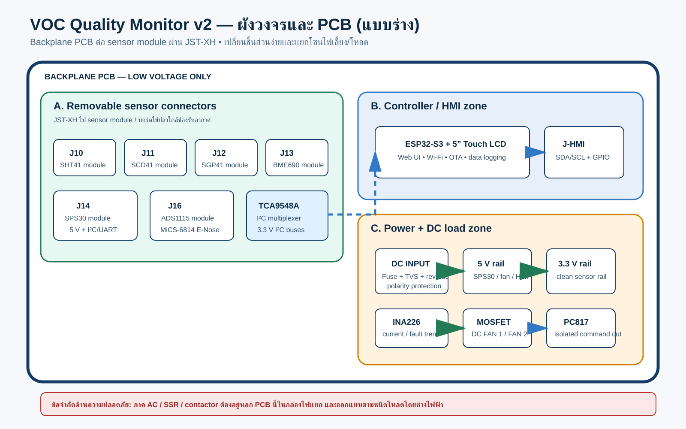
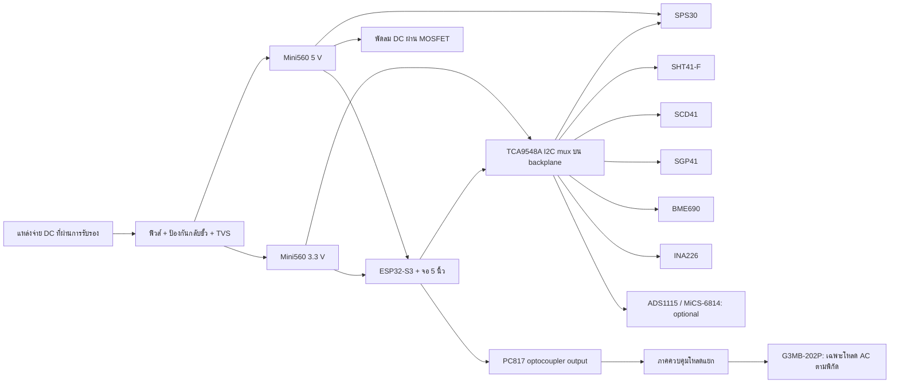

# แบบร่างวงจรและ PCB รุ่น 2 (Preliminary Design)

> สถานะ: แบบสถาปัตยกรรมเพื่อ review ก่อนออก schematic/PCB จริง ไม่ใช่แบบผลิตหรือแบบต่อไฟเมนส์
>
> เป้าหมาย: กล่องตรวจคุณภาพอากาศสำหรับพื้นที่พ่นสีฝุ่น โดยใช้ ESP32-S3 จอ 5 นิ้วเป็น HMI/Controller, ให้ PCB หลักเป็น backplane และต่อ sensor module แบบถอดเปลี่ยนได้ผ่าน JST-XH



## 1. ขอบเขตและหลักการออกแบบ

แบบนี้ใช้ชิ้นส่วนที่เลือกไว้: ESP32-S3 จอ 5 นิ้ว, BME690, SHT41-F, SCD41, SGP41, SPS30, TCA9548A, INA226, Mini560 5 V/3.3 V, PC817, LR7843 และ G3MB-202P รวมถึง MiCS-6814/ADS1115 หากต้องการเก็บ E-Nose แบบ analog จากระบบเดิม

หลักสำคัญคือ

- PCB หลักไม่มี sensor ติดตายตัว: sensor ทุกตัวเป็นโมดูลหรืออยู่บนบอร์ดไข่ปลา และต่อผ่าน JST-XH แบบถอดเปลี่ยนได้
- เซนเซอร์ I2C ใช้ราง **3.3 V ที่สะอาด** และใช้ I2C bus เดียวผ่าน TCA9548A
- SPS30 ใช้ **5 V สำหรับกำลัง** แต่สัญญาณ I2C/UART ต้องเป็น 3.3 V
- ใช้ Mini560 5 V สำหรับ HMI, SPS30 และพัดลม DC เท่านั้น; 3.3 V แยกสำหรับ logic/sensor
- วงจร AC และภาคขับโหลดเป็น **PCB/กล่องย่อยแยก** ไม่ลากลายทองแดง AC บน sensor PCB รุ่นแรก
- สัญญาณควบคุมโหลดมี optocoupler และ default เป็น OFF เมื่อ ESP32 reset หรือสายขาด

## 2. Block diagram



## 3. วงจรไฟเลี้ยงที่เสนอ

### 3.1 อินพุต

ให้รับเฉพาะ **DC ภายนอกที่ผ่านการรับรอง** ที่ `J1` (เช่น adaptor/industrial PSU ที่เลือกให้เหมาะกับแรงดันอินพุต Mini560 จริง) ไม่ให้นำ 220/230 VAC เข้า sensor PCB

```text
J1 DC_IN+ -- F1 -- Q1 reverse-polarity MOSFET -- +VIN_PROTECTED
                         |                         |
                         +-- TVS1 -- GND           +-- C1 100 uF + C2 1 uF
J1 DC_IN- --------------------------------------------- GND

+VIN_PROTECTED --> U1 Mini560 5 V  --> +5V_LOAD
                 --> U2 Mini560 3.3 V --> +3V3_SENSOR
```

ต้องยืนยัน `ช่วงแรงดันอินพุต`, กระแสพัดลม, และกำลังรวมก่อนเลือก F1/TVS/ขนาดสาย. ราง 3.3 V ต้องเพิ่ม LC/ferrite bead และ capacitor ใกล้ connector ทุกตัว (อย่างน้อย 100 nF + 4.7–10 uF ต่อกลุ่มเซนเซอร์)

### 3.2 การวัดกระแส

วาง INA226 พร้อม shunt ที่ราง `+5V_LOAD` เพื่อดูการใช้ไฟของ SPS30/พัดลมและช่วยตรวจพัดลมหยุด, เซนเซอร์หลุด หรือแหล่งจ่ายผิดปกติ. อย่าใช้มันเป็นอุปกรณ์ป้องกันกระแสเกินแทนฟิวส์

## 4. I2C และ connector sensor แบบถอดเปลี่ยนได้

### 4.1 Topology

ให้ ESP32-S3 ต่อ `MCU_SDA`, `MCU_SCL` ไป `TCA9548A` ที่ 3.3 V. ระบุ net name ก่อน เนื่องจาก GPIO ของบอร์ดจอ JC8048W550C ต้องตรวจจาก schematic/pinout ของรุ่นจริงก่อน lock ขา

| ช่อง TCA9548A | อุปกรณ์ | Address ปกติ | Connector | ข้อควรระวัง |
|---|---|---:|---|---|
| CH0 | SHT41-F | 0x44 | J10 | วางห่าง heat source และช่องลมร้อน |
| CH1 | SCD41 | 0x62 | J11 | ช่องอากาศต้องไม่รับลมร้อนจาก ESP32/regulator |
| CH2 | SGP41 | 0x59 | J12 | firmware ต้องส่ง temperature/RH compensation |
| CH3 | BME690 | 0x76 หรือ 0x77 | J13 | ยืนยันโมดูล/ที่อยู่จริงก่อนประกอบ |
| CH4 | SPS30 | 0x69 (ถ้าใช้ I2C) | J14 | ใช้ 5 V supply, I2C 3.3 V เท่านั้น |
| CH5 | INA226 | ตั้งด้วย strap | J15 | ใช้ตรวจราง +5V_LOAD |
| CH6 | ADS1115 (ทางเลือก) | 0x48 | J16 | สำหรับ MiCS-6814 raw analog เท่านั้น |
| CH7 | สำรอง | - | J17 | สำหรับเซนเซอร์/โมดูลเพิ่มในอนาคต |

ให้วางเฉพาะ JST-XH connector บน backplane; sensor ทุกตัวอยู่บน module/บอร์ดไข่ปลาที่ถอดเปลี่ยนได้. ใช้ connector ฝั่งสายแบบ housing มี key และกำหนดหมายเลข J10–J17 บน silkscreen ชัดเจน

| Connector มาตรฐาน | จำนวน pin | ลำดับ pin ที่บังคับใช้ | ใช้กับ |
|---|---:|---|---|
| `J10–J13`, `J17` | 4 | `1=3V3, 2=GND, 3=SDA, 4=SCL` | SHT41, SCD41, SGP41, BME690, sensor I2C เพิ่มเติม |
| `J14` | 6 | `1=5V, 2=GND, 3=SDA, 4=SCL, 5=TX, 6=RX` | SPS30; ใช้ I2C หรือ UART ตาม firmware |
| `J15` | 4 | `1=3V3, 2=GND, 3=SDA, 4=SCL` | INA226 module |
| `J16` | 4 | `1=3V3, 2=GND, 3=SDA, 4=SCL` | ADS1115 module |

หากมีสายยาวเกิน 30 cm หรือเดินผ่านใกล้พัดลม/ภาคกำลัง ให้ใช้สาย twisted pair (GND-SDA และ GND-SCL) หรือย้าย I2C เป็น differential bus; JST-XH ไม่ได้แก้ปัญหา noise ด้วยตัวเอง

**Pull-up:** ติดตั้ง pull-up 4.7 kOhm ที่ upstream bus หนึ่งชุด และใส่ footprint pull-up แบบ DNP บนแต่ละ channel; ไม่ populate ซ้ำกับโมดูลที่มี pull-up อยู่แล้วโดยไม่วัดค่ารวม. ตั้ง I2C ที่ 100 kHz ก่อนในรุ่นแรก

### 4.2 E-Nose analog (ถ้าใช้ MiCS-6814)

MiCS-6814 และ ADS1115 อยู่บน daughterboard/บอร์ดไข่ปลาฝั่งลมแยกจาก SHT41/SCD41. ห้ามป้อนแรงดัน analog ที่เกิน 3.3 V เข้า ADS1115. ต้องรู้ board revision ของ MiCS ก่อนจึงจะกำหนด voltage divider และ reference ได้; อย่า copy ค่า divider จากบอร์ดเก่าโดยไม่วัด AOUT จริง

## 5. ภาคขับพัดลมและโหลด

### 5.1 พัดลม DC

LR7843 ใช้ได้เฉพาะเมื่อพัดลมเป็น DC และยืนยัน rating ของโมดูลแล้ว:

```text
+5V_LOAD ---- FAN+   FAN- ---- Q_FAN (N-MOSFET low side) ---- GND
                                  |
ESP32 GPIO -- 100R -- gate     100k pull-down to GND

สำหรับพัดลมแบบ brushed: diode flyback คร่อมพัดลม
```

มี connector พัดลม 2 ช่อง (`J20`, `J21`) และวัดกระแสด้วย INA226. GPIO ต้องมี pull-down ภายนอกเพื่อ OFF ระหว่าง boot.

### 5.2 โหลด AC / G3MB-202P

**ไม่รวมลาย AC และ terminal mains ใน PCB เซนเซอร์นี้**. G3MB-202P มีพิกัดจำกัดและไม่ควรสั่งมอเตอร์/พัดลมโรงงานโดยตรง. หากต้องควบคุมโหลด AC ให้ใช้กล่องควบคุมไฟฟ้าแยก โดยช่างไฟออกแบบอุปกรณ์ป้องกัน, fuse/MCB, contactor หรือ industrial SSR ให้ตรงกับชนิดโหลดและกระแสกระชาก

PCB นี้ส่งเพียงสัญญาณ `LOAD1_CMD`/`LOAD2_CMD` ผ่าน PC817 ไปยัง terminal low-voltage isolated (`J30`) เท่านั้น. ต้องยืนยันว่า PC817 module แยก ground ได้จริงตาม schematic ของโมดูล; ไฟ LED บนบอร์ดสำเร็จรูปบางรุ่นอาจทำให้ isolation ไม่สมบูรณ์

## 6. ผังวาง PCB (2 ชั้น, backplane board)

```text
ด้านบน: เขตอากาศสะอาด/สัญญาณ                    ด้านล่าง: เขตพลังงาน/โหลด
┌─────────────────────────────────────────────────────────────────────┐
│ J10 SHT41  J11 SCD41    J12 SGP41   J13 BME690  ← JST-XH connectors │
│                                                                     │
│                  [ TCA9548A ] [pull-up/DNP]                         │
│ J14 SPS30  J16 ADS/MiCS  ← JST-XH     Header ไป ESP32-S3 HMI         │
│                                                                     │
│-------------------------- keep-out / GND guard ---------------------│
│ J1 DC IN | Fuse/TVS/reverse | Mini560 5V | Mini560 3V3 | INA226      │
│ J20 FAN1 | J21 FAN2         | MOSFETs    | J30 isolated low-voltage │
└─────────────────────────────────────────────────────────────────────┘
```

- วาง JST-XH sensor connector ไว้ริม backplane เพื่อเปลี่ยนโมดูลได้โดยไม่ต้องถอดจอหรือภาคจ่ายไฟ
- ติดตั้ง SHT41, SCD41, SGP41, BME690 บนแผ่นยึด/บอร์ดไข่ปลาที่อยู่ใกล้ช่องลม แต่แยกจากจอ, ESP32, buck converter, SPS30 exhaust และ heater ของ MiCS
- วาง buck converter, MOSFET, fan connector และสายกำลังใกล้ขอบอีกด้านหนึ่ง
- ทำ ground plane เต็มทั้งสองด้าน; ให้เส้นกระแสพัดลมกลับทางสั้นและไม่วิ่งใต้ I2C/analog
- ใช้ star connection จาก power entry สำหรับ return กระแสสูง; ไม่ใช้สาย Dupont เป็นสายกำลังหลัก
- เพิ่ม test point: `VIN`, `5V`, `3V3`, `GND`, `SDA`, `SCL`, `FAN1`, `FAN2`, `I_LOAD`
- ใช้ keyed locking connector (JST-GH, Molex MicroFit หรือเทียบเท่า) สำหรับการติดตั้งจริง; Dupont ใช้เฉพาะ bench prototype

## 7. BOM ที่ต้องเพิ่มก่อนทำ PCB

| กลุ่ม | รายการที่ต้องเพิ่ม | เหตุผล |
|---|---|---|
| Protection | fuse holder/fuse, TVS, reverse-polarity MOSFET, ESD diode | ป้องกันต่อผิด/ไฟกระชาก/สายยาว |
| Decoupling | 100 nF, 1 uF, 10 uF, 100 uF ตามตำแหน่ง | ลด reset และ noise ของเซนเซอร์ |
| I2C | footprint pull-up DNP, series 22–47 Ohm (option) | แก้ bus capacitance/pull-up ซ้ำได้โดยไม่ตัดลาย |
| Fan | flyback diode (ถ้าเป็น brushed), gate resistor, gate pull-down | ป้องกัน transient และ boot เปิดพัดลมเอง |
| Mechanical | locking connectors, standoff, strain relief, cable gland | ความทนทานในกล่องโรงงาน |
| Safety | enclosure ที่เหมาะสม, earth/grounding plan, อุปกรณ์ควบคุม AC โดยช่าง | ลดความเสี่ยงไฟฟ้าและฝุ่น |

## 8. สิ่งที่ต้องยืนยันก่อนออก KiCad schematic และ Gerber

1. Part number และ pinout/schematic ของบอร์ดจอ ESP32-S3 รุ่นที่ซื้อจริง รวมถึง GPIO ที่จอ/Touch/SD ใช้อยู่
2. อินพุต DC ที่จะใช้จริง, กระแสสูงสุดของพัดลม และจะใช้พัดลม DC หรือ AC
3. รุ่นและภาพด้านหลังของโมดูล BME690, SHT41-F, SGP41, SPS30, INA226, PC817 และ LR7843 เพื่อเช็ค level voltage, pull-up และ connector
4. ใช้ MiCS-6814/ADS1115 ต่อใน v2 หรือแยกเป็น board ทดลอง E-Nose
5. ภาค AC จะควบคุมอะไร, แรงดัน/กระแส/ชนิดโหลด และใครเป็นผู้รับผิดชอบการออกแบบโดยช่างไฟฟ้าที่มีคุณสมบัติ
6. ขนาดกล่อง, ตำแหน่งช่องลม, ทิศทางพัดลม และระยะห่างจากพื้นที่มีฝุ่น/ไอที่อาจติดไฟ

เมื่อมีคำตอบครบ จึงทำได้อย่างปลอดภัย: (1) KiCad schematic ของ backplane, (2) ERC, (3) PCB 2-layer พร้อม JST-XH/mounting holes/keep-out, (4) DRC และ (5) PDF pinout/assembly สำหรับช่างประกอบ

## 9. เกณฑ์รับงานก่อนนำไปใช้

- วัด 5.0 V และ 3.3 V ภายใต้โหลดพัดลม/จอ: ไม่เกิน tolerance ที่อุปกรณ์ยอมรับ และไม่มี ESP32 reset
- I2C scan เห็นเฉพาะ address ที่คาดไว้ทุกครั้งหลัง power cycle อย่างน้อย 50 รอบ
- ทดสอบ fan ON/OFF 1,000 รอบโดยไม่มีค่า sensor spike ที่ถูกนำไปเป็น alarm
- ตรวจ continuity, polarity และอุณหภูมิของ buck/MOSFET ก่อนติดตั้งในกล่อง
- เทียบค่า SHT41/SCD41/SPS30/SGP41 กับแหล่งอ้างอิงตามแผน validation; ไม่ประกาศ ppm สารเฉพาะเจาะจงจาก E-Nose โดยไม่มี ground truth
