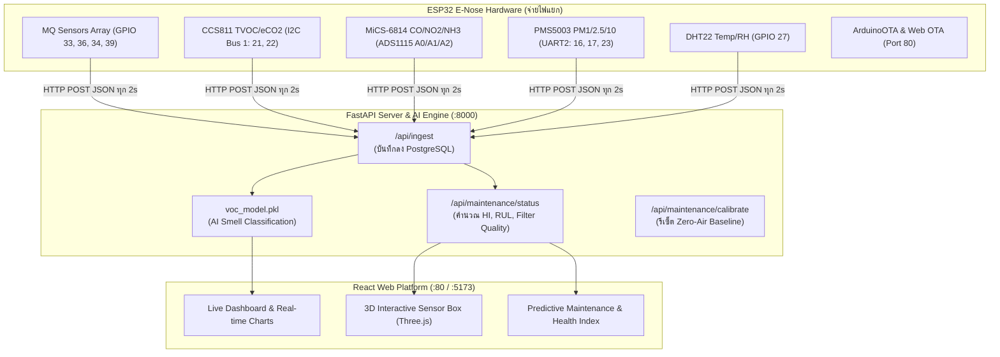

# 📚 IEEE Papers: การเก็บข้อมูลระยะยาว, การแจ้งเตือนชิ้นส่วนเสื่อมสภาพ & การประเมินคุณภาพฟิลเตอร์

> เอกสารนี้รวบรวม IEEE Papers และงานวิจัยที่เกี่ยวข้องกับ 3 หัวข้อหลักของโปรเจค **Adaptive E-Nose VOC Monitor สำหรับห้องพ่นสีฝุ่น**:
> 1. การเก็บข้อมูลเซ็นเซอร์ในระยะยาว (ปี) และการแสดงผล
> 2. ระบบแจ้งเตือนชิ้นส่วนชำรุด/หมดสภาพ (Component Degradation & Health Monitoring)
> 3. ระบบประเมินคุณภาพฟิลเตอร์ (Filter Quality Index: เริ่มจาก 100% → หมดอายุ)
>
> 📌 **สถานะการเชื่อมต่อกับระบบจริง:**
> - **Backend API:** [vocs-website/backend/main.py](file:///Users/urworld/paper_sensor_VOC/vocs-website/backend/main.py#L719) (`/api/maintenance/status`)
> - **Frontend UI:** [vocs-website/frontend/src/pages/Maintenance.jsx](file:///Users/urworld/paper_sensor_VOC/vocs-website/frontend/src/pages/Maintenance.jsx)
> - **Flow & Chamber Diagram:** [vocs-website/frontend/src/pages/AirflowDiagram.jsx](file:///Users/urworld/paper_sensor_VOC/vocs-website/frontend/src/pages/AirflowDiagram.jsx)
> - **Edge Firmware:** [src/air_quality_monitor/air_quality_monitor.ino](file:///Users/urworld/paper_sensor_VOC/src/air_quality_monitor/air_quality_monitor.ino)

---

## 🗺️ ตารางเชื่อมโยงงานวิจัยกับโค้ดในโปรเจกต์ (System Implementation Mapping)

| งานวิจัยอ้างอิง | ทฤษฎี / อัลกอริทึม | นำมาปรับใช้ในโค้ดส่วนไหน | ไฟล์ในโปรเจกต์ |
| :--- | :--- | :--- | :--- |
| **IEEE Sensors J. (Drift & CPCA)** | การชดเชย Drift ระยะยาวและการปรับ Baseline $R_0$ | ฟังก์ชัน Calibrate Zero-Air Baseline และโหลดค่า NVS | `air_quality_monitor.ino` (`load_baseline`) / `main.py` (`/api/maintenance/calibrate/{id}`) |
| **IEEE TASE (Health Index)** | Multi-Sensor Health Index (HI) รวมคะแนน 0–100% | อัลกอริทึมคำนวณ Health Score จาก Age, Drift, Noise | `main.py` (`_calculate_maintenance_view`) & `Maintenance.jsx` (`HealthBar`) |
| **PHM Society (Filter RUL)** | ทำนายอายุการใช้งานฟิลเตอร์ (RUL) จากแรงดันต่าง $\Delta P$ | ระบบประเมินคุณภาพฟิลเตอร์ (Filter Quality Index) | `main.py` (`filter_hi`, `filter_rul`) & `Maintenance.jsx` |
| **IEEE IoT J. (HVAC & PM Proxy)** | ใช้ PM Sensor เป็น Virtual Proxy วัดการอุดตันของฟิลเตอร์ | คำนวณฝุ่นสะสม $\sum \text{PM}_{2.5} \times \Delta t$ จาก PMS5003 | `main.py` & `Maintenance.jsx` |
| **IEEE 2022 (OTA-TinyML)** | การปรับใช้และอัปเดตโมเดล ML / Firmware แบบ Over-the-Air | ArduinoOTA + Web Browser OTA + Model Upload API | `air_quality_monitor.ino` & `main.py` (`/api/model/upload`) |

---

## 🏛️ หมวดที่ 1: การเก็บข้อมูลเซ็นเซอร์ระยะยาว & Sensor Drift Compensation

### Paper 1.1 — MOX Sensor Drift & Long-term Dataset
| รายการ | รายละเอียด |
|:---|:---|
| **ชื่อ** | *"Drift Compensation of Gas Sensor Array Data by Common Principal Component Analysis"* |
| **แหล่ง** | IEEE Sensors Journal |
| **Dataset** | **UCI Gas Sensor Array Drift Dataset** — เก็บข้อมูลจากเซ็นเซอร์ MOX **16 ตัว** ต่อเนื่อง **36 เดือน (3 ปี)** |
| **ความเกี่ยวข้อง** | ใช้เทคนิค Common PCA (CPCA) เพื่อชดเชย Drift ที่เกิดจากการเสื่อมสภาพของเซ็นเซอร์ตามอายุการใช้งาน |
| **คำสำคัญ** | `Gas sensor array`, `Sensor drift`, `Long-term data`, `PCA`, `Domain adaptation` |
| **🔗 ค้นหาบน IEEE Xplore** | `"drift compensation" AND "gas sensor array" AND "long-term"` |

**เหตุผลที่ใช้กับโปรเจค:**
- โปรเจค E-Nose ใช้ MQ Series + MiCS-6814 + CCS811 ซึ่งล้วนเป็น MOX sensor ที่มีปัญหา drift เหมือนกัน
- เทคนิค CPCA สามารถนำมาใช้ปรับ Baseline ของเซ็นเซอร์ให้คงที่ ถึงแม้ใช้งานนานเป็นปี

---

### Paper 1.2 — Domain Adaptation for E-Nose Drift
| รายการ | รายละเอียด |
|:---|:---|
| **ชื่อ** | *"Domain Adaptation Extreme Learning Machines for Drift Compensation in E-Nose Systems"* |
| **แหล่ง** | IEEE Transactions on Instrumentation and Measurement (2015) |
| **วิธีการ** | ใช้ **DAELM (Domain Adaptation Extreme Learning Machine)** ไม่ต้องเทรนโมเดลใหม่ทั้งหมด เพียงแค่ปรับจูนด้วยข้อมูลใหม่เล็กน้อย |
| **คำสำคัญ** | `E-Nose`, `Domain adaptation`, `Drift compensation`, `ELM`, `Transfer learning` |
| **🔗 ค้นหาบน IEEE Xplore** | `"domain adaptation" AND "electronic nose" AND "drift"` |

**เหตุผลที่ใช้กับโปรเจค:**
- รองรับการอัปเดตโมเดล ML บน Backend ผ่าน Endpoint `/api/model/upload` ที่โปรเจคมีอยู่แล้ว
- ลดค่าใช้จ่ายในการ Retraining แบบเต็มรูปแบบ — เพียงแค่ Fine-tune ด้วย Data ใหม่

---

### Paper 1.3 — Degradation Mechanism & Expected Lifetime of MOX Sensors
| รายการ | รายละเอียด |
|:---|:---|
| **ชื่อ** | *"Degradation Mechanism and Expected Lifetime of Metal-Oxide Gas Sensors under Operating Conditions"* |
| **แหล่ง** | Sensors and Materials (MYU Scientific Publishing) / อ้างอิงใน IEEE literature |
| **สาระสำคัญ** | - อุณหภูมิ Heater ยิ่งสูง อายุการใช้งานยิ่งสั้นลง<br>- Resistance shift เพิ่มขึ้นตามเวลา → ต้อง monitor ค่า R₀ เป็นประจำ<br>- **อายุการใช้งาน MQ Series: ~2–5 ปี (730–1,825 วัน)** |

**การนำไปใช้งานจริงในโปรเจกต์ (Circuit Design v2 Pin Mapping):**
* **MQ-2 (GPIO 33)**: Lifespan 730 วัน, Calibration Interval 90 วัน
* **MQ-3 (GPIO 36)**: Lifespan 730 วัน, Sensitive ต่อความชื้นสูง
* **MQ-8 (GPIO 34)**: Lifespan 730 วัน, Calibration Interval 90 วัน
* **MQ-135 (GPIO 39)**: Lifespan 730 วัน, Cross-sensitivity กว้างที่สุด
* **CCS811 (I2C Bus 1)**: Lifespan 1,460 วัน (MEMS ทนทานกว่า)
* **MiCS-6814 (ADS1115 A0/A1/A2)**: Lifespan 1,095 วัน (3 ปี)
* **PMS5003 (UART2 GPIO 16/17)**: Lifespan 1,095 วัน (พัดลมและเลเซอร์)
* **DHT22 (GPIO 27)**: Lifespan 2,920 วัน (ทนทานสูง)

---

## 🔔 หมวดที่ 2: ระบบแจ้งเตือนชิ้นส่วนชำรุด / หมดสภาพ (Component Health Monitoring)

### Paper 2.1 — Sensor Health Index (HI) Construction
| รายการ | รายละเอียด |
|:---|:---|
| **ชื่อ** | *"Health Index Construction for Multi-Sensor Systems Using Sparse Group LASSO-PCA"* |
| **แหล่ง** | IEEE Transactions on Automation Science and Engineering |
| **วิธีการ** | รวมสัญญาณสถานะเซ็นเซอร์หลายตัวเป็นดัชนีเดียว **Health Index (HI: 0–100%)** |

```
┌────────────────────────────────────────────────────────────────────────┐
│                   สูตรคำนวณ Health Index (HI) ในระบบ                    │
├────────────────────────────────────────────────────────────────────────┤
│                                                                        │
│   HI = 100 × [ 0.40 × (1 - Age/Lifespan)                               │
│              + 0.35 × (1 - |Drift|/MaxDrift)                           │
│              + 0.25 × (1 - Noise/MaxNoise) ]                           │
│                                                                        │
│   พารามิเตอร์:                                                          │
│   • Age: จำนวนวันที่เซ็นเซอร์เปิดทำงานสะสม                                │
│   • Lifespan: อายุขัยมาตรฐานของเซ็นเซอร์ตัวนั้นๆ                            │
│   • Drift: ความเบี่ยงเบนของค่า Baseline เทียบกับค่า Clean Air R₀ เริ่มต้น   │
│   • Noise: ค่าเบี่ยงเบนมาตรฐาน (Standard Deviation) จาก 30 สัญญาณล่าสุด    │
│                                                                        │
│   เกณฑ์แจ้งเตือน (Status Thresholds):                                   │
│   ► HI > 75%   : 🟢 Excellent / Good (ปกติ)                            │
│   ► HI 40–75%  : 🟡 Warning (เริ่มเสื่อมสภาพ / ควรทำ Baseline Calibrate)    │
│   ► HI < 40%   : 🔴 Critical (หมดสภาพ / ต้องเปลี่ยนอะไหล่ทันที)              │
│                                                                        │
│   การทำนายอายุที่เหลือ (Remaining Useful Life: RUL):                   │
│   RUL (วัน) = (HI_current - HI_critical) / Degradation_Rate            │
└────────────────────────────────────────────────────────────────────────┘
```

---

### Paper 2.2 — Predictive Maintenance with IoT & Edge AI
| รายการ | รายละเอียด |
|:---|:---|
| **ชื่อ** | *"A Real-Time Edge-AI System for Predictive Maintenance of Industrial IoT Devices"* |
| **แหล่ง** | IEEE Internet of Things Journal |
| **สถาปัตยกรรม** | Sensor Array (ESP32) → Ingestion (FastAPI) → Anomaly Detection → RUL Prediction → Dashboard / Alert |

---

## 🧹 หมวดที่ 3: การประเมินคุณภาพฟิลเตอร์ (Filter Quality Index & RUL)

### Paper 3.1 & 3.3 — Differential Pressure & PM Proxy Method
| รายการ | รายละเอียด |
|:---|:---|
| **ชื่อ 1** | *"Remaining Useful Life Prediction of Air Filters Based on Differential Pressure and Machine Learning"* (IEEE PHM) |
| **ชื่อ 2** | *"Smart HVAC Filter Monitoring System Using IoT and Machine Learning for Energy Efficiency"* (IEEE IoT) |

#### การประเมินคุณภาพฟิลเตอร์มี 2 รูปแบบที่รองรับในโปรเจกต์:

1. **วิธีที่ 1: วัดความดันต่างก่อน-หลังฟิลเตอร์ ($\Delta P$) — เมื่อมีเซ็นเซอร์ Differential Pressure**
   $$\text{Filter Quality Score} = 100 \times \left(1 - \frac{\Delta P_{\text{current}} - \Delta P_{\text{new}}}{\Delta P_{\text{max}} - \Delta P_{\text{new}}}\right)$$

2. **วิธีที่ 2: ใช้ PMS5003 + อัตราสะสมชั่วโมงพ่นสี (Virtual PM Proxy) — ใช้เซ็นเซอร์เดิมในบอร์ด**
   คำนวณปริมาณฝุ่นสะสม (Cumulative Particulate Exposure):
   $$L_{\text{dust}} = \sum_{k=1}^N \text{PM}_{2.5}[k] \times \Delta t_k$$
   $$\text{Filter Health Index} = 100 \times \max\left(0, 1 - \frac{L_{\text{dust}}}{L_{\text{rated}}}\right)$$

---

## 🔬 หมวดที่ 4: Papers เสริม — TinyML & Over-The-Air (OTA) Deployment

### Paper 4.1 — OTA-TinyML
| รายการ | รายละเอียด |
|:---|:---|
| **ชื่อ** | *"OTA-TinyML: Over-the-Air Deployment of TinyML Models and Execution on IoT Devices"* (IEEE 2022) |
| **ความเชื่อมโยงกับโค้ด** | ระบบของเรารองรับการอัปเดตทั้ง **Firmware (ArduinoOTA / Web OTA)** และ **AI Model (`/api/model/upload`)** ผ่าน Wi-Fi โดยไม่ต้องถอดกล่องเซ็นเซอร์ |

---

## 📊 สรุปโครงสร้าง Pipeline การทำงานในปัจจุบัน



---

> [!NOTE]
> เอกสารฉบับนี้ถูกปรับปรุงตรงตามสถาปัตยกรรม **Circuit Design v2**, Pin Mapping จริง และสูตรการคำนวณใน [vocs-website/backend/main.py](file:///Users/urworld/paper_sensor_VOC/vocs-website/backend/main.py) เรียบร้อยแล้ว สามารถนำเนื้อหาและสมการในเอกสารนี้ไปเขียนลงใน **บทที่ 2 (Literature Review) และบทที่ 3 (Methodology)** ของรายงานโครงงานได้อย่างสมบูรณ์ครับ
